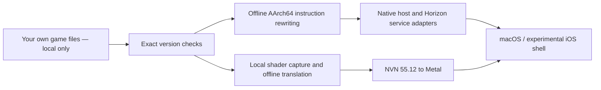

# Bayonetta 3 Mobile

English | [简体中文](README.zh-CN.md)

An experimental, open-source native compatibility layer for running your own Nintendo Switch copy of **Bayonetta 3** on Apple silicon macOS, with an iOS port in development. Built on [d2r-mobile](https://github.com/jhaizhou-ops/d2r-mobile) and [blade2-mobile](https://github.com/ha7rock/blade2-mobile).

> **Support the original game. Buy a legitimate copy. Bring your own game files.**
>
> This repository provides compatibility-layer source code, build tools and tutorials only. **We do not provide, host, link to, or accept NSP/XCI/NSZ files, keys, tickets, game executables, extracted assets, original or translated game shaders, or packages containing game content.** Prepare your own files from a copy you legally own, where permitted. Do not upload them to GitHub, Issues, pull requests, Releases or Actions artifacts. No game downloads or game-sharing support is offered. See [Game files policy](docs/GAME_FILES.md).

This is an independent community project, not an official port and not affiliated with or endorsed by Nintendo, PlatinumGames or SEGA. Game names and trademarks belong to their respective owners. The source license does not license the game.

## Current status

Developer observations as of **2026-10-17**; a research preview, not a finished port.

| Area | What has actually been verified |
|---|---|
| macOS, Apple silicon | Native startup, title/menu, opening real-time 3D, left/right movement, turning and action feedback |
| NVN / graphics | Targeted NVN **55.12** compatibility, Metal rendering, offline translation of supported shader stages |
| Performance | Metal HUD works. Selected opening-scene samples are near 60 FPS, GPU median roughly 11–12 ms; frame drops and a long pause also occurred. This is not a steady-60-FPS claim or a whole-game benchmark |
| iOS | Unsigned source build and observed-path shaders compile. Signing/install and real-device gameplay have **not** been verified |
| Still unverified | Complete combat and chapters, audio quality, save round trips, later rendering paths and device lifecycle |

Known issues include material/hair/transparency artifacts, performance variation, and unsupported tessellation stages. A local batch compiled 6,293 supported-stage shaders; 11 tessellation captures remain unsupported. This does not establish complete shader or game compatibility. Local evidence paths and limitations are recorded in [STATUS.md](docs/STATUS.md); private logs and captures are intentionally not published.

## How it works



The game program runs as rewritten native ARM64 code. The host supplies its platform services, and the graphics layer implements the required NVN operations using Metal. Ryujinx's MIT-licensed shader translation library is used **offline at build time**; the Ryujinx emulator application is not required to run this host. Videos are decoded locally from caches you generate from your own originals.

Only the profiled **Switch version 1.2.0**, Program ID `01004a4010fea000`, is currently accepted. Build IDs and SHA-256 checks reject mismatched modules. Unknown calls and missing shaders fail visibly in the default strict mode. Read the [implementation analysis](docs/ARCHITECTURE.md) for the changes and their limits.

## Build and run

You need an Apple silicon Mac, macOS 26+, a full Xcode installation with its Metal toolchain, Python, LLVM, .NET 10, SPIRV-Cross, FFmpeg and your own local game files. The tested development environment uses Xcode 27; older systems/toolchains are not verified.

```sh
git clone https://github.com/enginefuture/bayonetta3-mobile.git
cd bayonetta3-mobile
make setup
```

Continue with the **[English build tutorial](docs/BUILD.md)** or **[中文构建教程](docs/BUILD.zh-CN.md)**. They cover local preparation, rewriting and verification, building the shader translator from source, the capture/compile/strict-run cycle, Metal HUD, and experimental iOS builds. A fresh clone contains no prebuilt game program or shader cache; it is not ready to run until you complete those steps.

After preparing and validating your local workspace:

```sh
.venv/bin/python tools/run_mac.py --seconds 0 --metal-hud
```

`0` disables the diagnostic time limit. Close the window or press Command-Q to quit. Add `--metal-hud-log` to record HUD statistics in the private run log.

| Keyboard | Switch input |
|---|---|
| WASD | Left stick |
| J / Space, K, U, I | A, B, X, Y |
| Q / E, Z / C | L / R, ZL / ZR |
| Arrow keys | D-pad |
| Return / Tab | Plus / Minus |

## Project layout

| Path | Purpose |
|---|---|
| `tools/` | Local preparation, module checks, build and launch wrappers |
| `config/` | Version fingerprints and interface names, no game bytes |
| `platform/ios/` | Experimental UIKit/Metal shell and project specification |
| `tests/` | Synthetic rewrite, ABI and GPU regression tests |
| `third_party/` | Pinned upstream source and third-party licenses |
| `docs/` | Tutorials, architecture, observed status and upstream changes |
| `work/` | **Private and Git-ignored**: all game inputs, keys, saves, generated outputs and run evidence |

## Contributing

See [CONTRIBUTING.md](CONTRIBUTING.md). Reports should include your OS, hardware, tool versions and a redacted error summary. Never attach game data or keys. Tests that do not require game files:

```sh
make test
make test-gpu  # Apple silicon Mac with Metal
```

Before publishing changes, stage only reviewed source files and run `python3 tools/audit_public.py --all-history`. CI repeats the source-content audit. `.gitignore` is one guard; the audit also checks the actual Git index/history, including force-added files. It cannot establish legal provenance of every byte, so contributors must still review what they submit.

## Credits and license

Compatibility-layer code is available under the [MIT License](LICENSE), with original notices retained. The host/graphics foundation is vendored from blade2-mobile commit `c981fcb62fe9962ca81d359f639bd05117bd03b4`, inheriting d2r-mobile's method and code. See [THIRD_PARTY_NOTICES.md](THIRD_PARTY_NOTICES.md), [UPSTREAM.json](third_party/UPSTREAM.json), [upstream changes](docs/UPSTREAM_CHANGES.md) and [interface metadata inventory](docs/DERIVED.md).

**No NSP files. No keys. No game assets. No game-containing downloads. Support legitimate purchases.**
