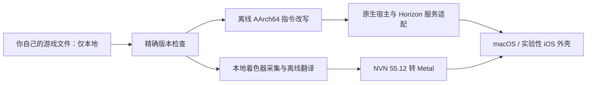

# Bayonetta 3 Mobile

[English](README.md) | 简体中文

面向 Apple silicon macOS 的开源原生兼容层研究项目，用于运行你自己拥有的 Nintendo Switch 版 **Bayonetta 3（猎天使魔女 3）**，iOS 移植仍在开发中。基于 [d2r-mobile](https://github.com/jhaizhou-ops/d2r-mobile) 与 [blade2-mobile](https://github.com/ha7rock/blade2-mobile) 的方法和代码。

> **支持正版，请购买正版游戏，自行准备自己的游戏文件。**
>
> 本仓库仅提供兼容层源码、构建工具和使用教程。**我们不提供、不托管、不链接、也不接受任何 NSP/XCI/NSZ、密钥、票据、游戏可执行文件、提取资源、原始或翻译后的游戏着色器，以及包含游戏内容的安装包。** 请在允许的范围内，从自己合法拥有的副本准备文件。不要将这些内容上传到 GitHub、Issue、PR、Release 或 Actions 产物。项目不提供游戏下载或游戏文件分享支持。详见[游戏文件政策](docs/GAME_FILES.zh-CN.md)。

这是独立社区项目，并非官方移植，与任天堂、PlatinumGames 或 SEGA 无关联，也未获其背书。游戏名称、商标及内容归相应权利人所有。源码许可证不包含游戏授权。

## 当前状态

以下为 **2026-10-17** 的开发实测，项目仍是研究预览版。

| 项目 | 已实际验证的范围 |
|---|---|
| Apple silicon Mac | 原生启动、标题/菜单、开场实时 3D、左右移动、转向和动作反馈 |
| NVN / 图形 | 目标所需的 NVN **55.12** 接口适配、Metal 渲染、受支持阶段的离线着色器翻译 |
| 性能 | Metal HUD 已生效；部分开场采样接近 60 FPS，GPU 中位耗时约 11–12 ms；同时存在掉帧和长停顿，不能宣传稳定 60 FPS 或全流程性能 |
| iOS | 未签名源码构建及已观察路径的着色器编译通过；**尚未验证签名安装及真机运行** |
| 尚待验收 | 完整战斗与章节、音频质量、存档读写往返、后续图形路径及设备生命周期 |

已知还有材质/发丝/透明效果问题、性能波动和细分阶段未支持。本机批次编译通过 6293 个受支持阶段的着色器，另有 11 个细分阶段采集尚不支持；这不代表着色器或游戏全流程兼容。实测范围和本地证据路径见 [STATUS.md](docs/STATUS.md)，原始日志与截图不公开分发。

## 实现方式



游戏程序经过离线改写后，以原生 ARM64 代码执行；宿主实现其调用的平台服务，图形层将所需 NVN 操作映射到 Metal。构建阶段使用 Ryujinx 的 MIT 着色器翻译库，**运行宿主不依赖 Ryujinx 模拟器应用**。影片由自己原片生成的本地缓存解码。

当前仅接受配置中的 **Switch 1.2.0**，Program ID 为 `01004a4010fea000`。Build ID 与 SHA-256 不符时停止；默认严格模式遇到未知调用或缺失着色器会明确失败。详见[实现分析](docs/ARCHITECTURE.zh-CN.md)。

## 构建和运行

需要 Apple silicon Mac、macOS 26+、带 Metal 工具链的完整 Xcode、Python、LLVM、.NET 10、SPIRV-Cross、FFmpeg，以及自己的本地游戏文件。开发实测使用 Xcode 27，未验证旧系统/工具链。

```sh
git clone https://github.com/enginefuture/bayonetta3-mobile.git
cd bayonetta3-mobile
make setup
```

继续阅读 **[中文构建教程](docs/BUILD.zh-CN.md)** 或 **[English build tutorial](docs/BUILD.md)**：包括本地准备、改写与验证、从源码构建翻译器、采集/编译/严格运行循环、Metal HUD 及实验性 iOS 构建。干净克隆不含预生成的游戏程序和着色器，完成这些步骤后才能尝试运行。

本地工作区准备并验证完成后：

```sh
.venv/bin/python tools/run_mac.py --seconds 0 --metal-hud
```

`0` 表示取消诊断时限，关闭窗口或按 Command-Q 退出；加 `--metal-hud-log` 将 HUD 指标写入私有运行日志。

| 键盘 | Switch 输入 |
|---|---|
| WASD | 左摇杆 |
| J / 空格、K、U、I | A、B、X、Y |
| Q / E、Z / C | L / R、ZL / ZR |
| 方向键 | 十字键 |
| Return / Tab | 加号 / 减号 |

## 目录

| 路径 | 用途 |
|---|---|
| `tools/` | 本地准备、模块验证、构建与启动工具 |
| `config/` | 版本指纹及接口名，不含游戏字节 |
| `platform/ios/` | 实验性 UIKit/Metal 外壳及工程配置 |
| `tests/` | 合成改写、ABI 与 GPU 回归测试 |
| `third_party/` | 固定上游版本的源码和许可证 |
| `docs/` | 教程、实现分析、实测状态与上游修改记录 |
| `work/` | **私有且被 Git 忽略**：游戏输入、密钥、存档、生成产物及运行证据 |

## 参与开发

见 [CONTRIBUTING.md](CONTRIBUTING.md)。报告问题时提供系统、硬件、工具版本及脱敏错误摘要，不要附游戏文件或密钥。以下测试不需要游戏文件：

```sh
make test
make test-gpu  # 需要 Apple silicon Mac 和 Metal
```

发布修改前只暂存已审查的源码，再运行 `python3 tools/audit_public.py --all-history`。CI 会重复检查实际 Git 索引和历史，包括强制加入的文件。自动审计不能证明每个字节的来源，提交者仍须人工确认内容。

## 致谢与许可

兼容层源码采用 [MIT](LICENSE)，保留原作者声明。宿主/图形基础来自 blade2-mobile 提交 `c981fcb62fe9962ca81d359f639bd05117bd03b4`，继承 d2r-mobile 的方法与实现。详见[第三方声明](THIRD_PARTY_NOTICES.md)、[上游版本](third_party/UPSTREAM.json)、[修改记录](docs/UPSTREAM_CHANGES.md)和[接口元数据清单](docs/DERIVED.md)。

**仓库不存放任何 NSP，不提供密钥、游戏资源或含游戏内容的下载包。支持正版。**
